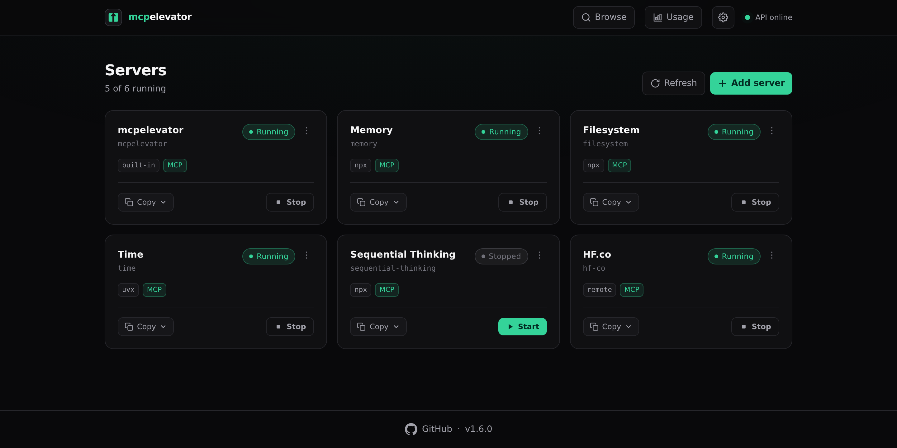
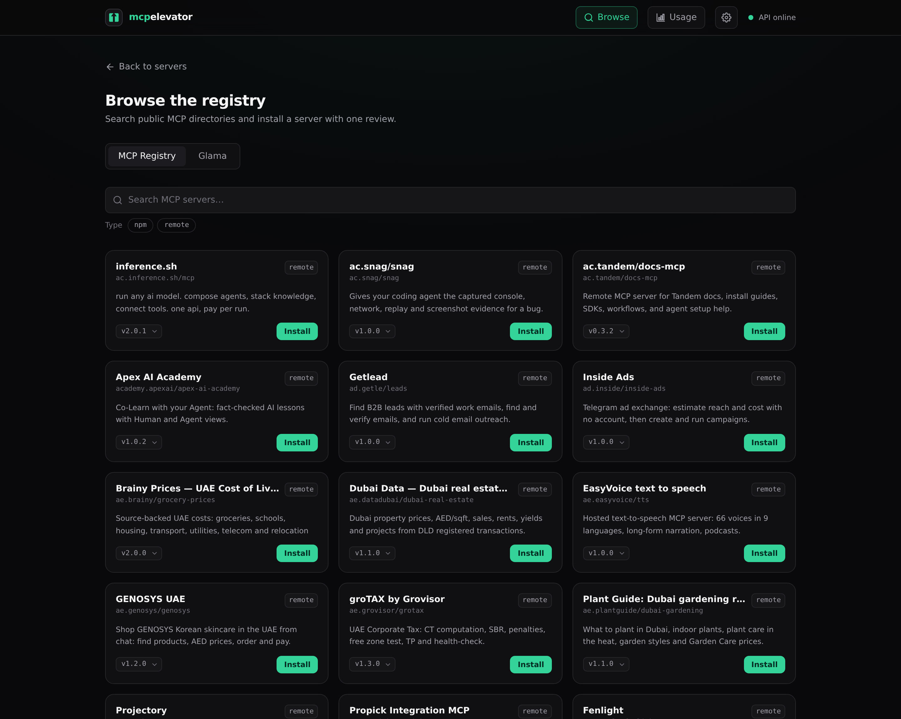
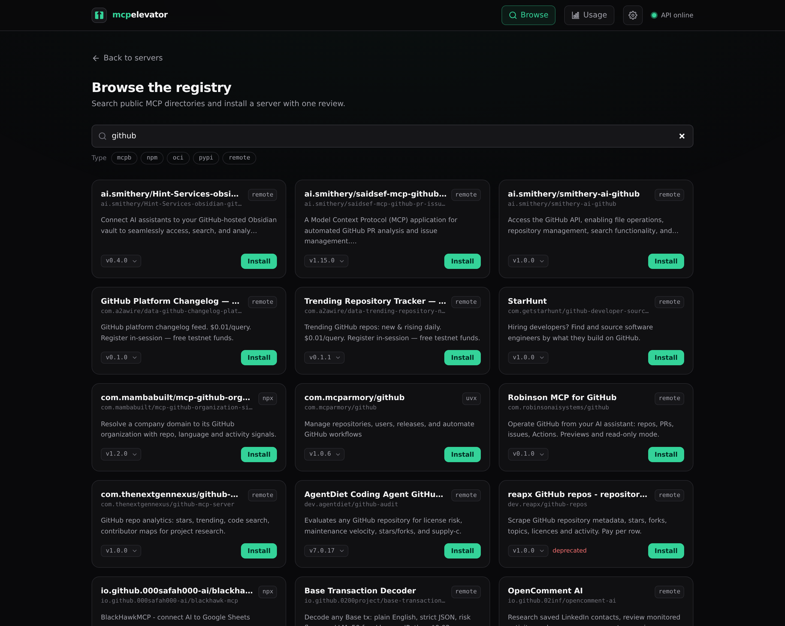
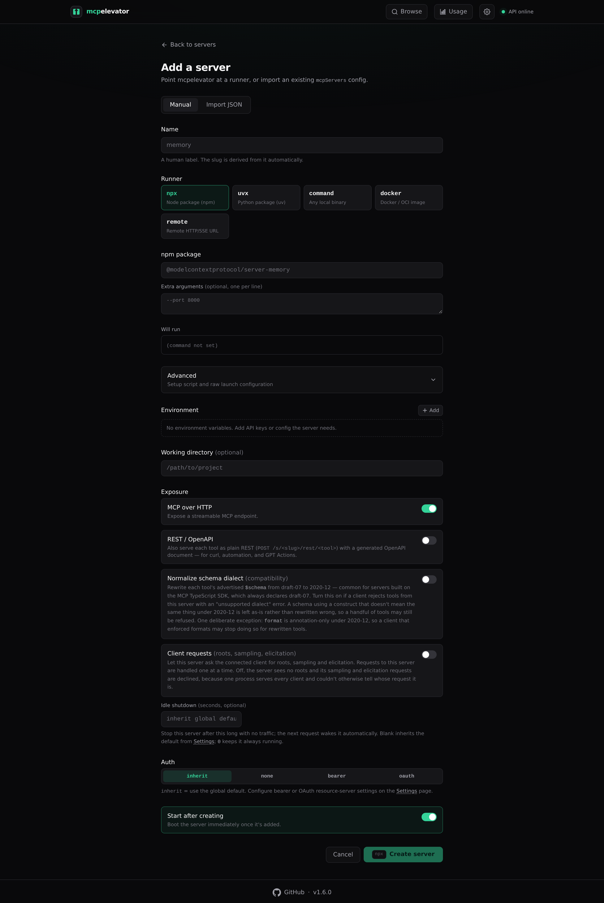
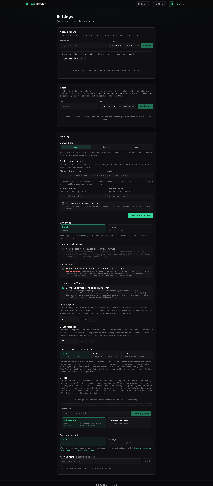
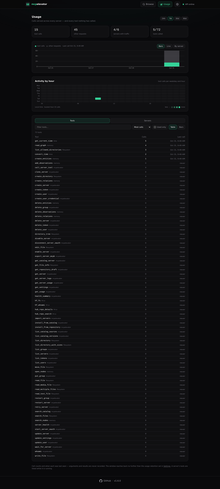
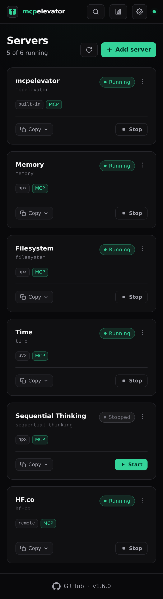

# mcpelevator

**Elevate MCP servers into authenticated HTTP endpoints. Self-hosted, in one container.**

Most [MCP](https://modelcontextprotocol.io) servers ship as **stdio** programs (`npx -y …`, `uvx …`, a command, a docker image). Stdio only works when the client can spawn the process locally, which **phones and most "any device" setups can't do**. mcpelevator runs those servers for you and exposes each one as a remote **Streamable HTTP** endpoint (the transport Claude mobile, Flutter clients, etc. connect to). Add a server, press start, copy the URL into your client. Each server can also opt into a plain **REST/OpenAPI** surface (`/s/<slug>/rest/<tool>`), so curl, automation, and GPT Actions can call its tools without speaking MCP.

Already-remote servers work too: point mcpelevator at an existing Streamable-HTTP/SSE MCP URL (the `remote` runner) and it proxies that upstream behind the same auth, supervision, and per-client copy menu as a local one — handy for putting bearer auth in front of a remote server, or giving every client one consistent endpoint.

The protocol bridging is done by [FastMCP](https://gofastmcp.com); mcpelevator is the **control plane**: a clean UI, process supervision, security, and onboarding around it.

## How it works

```
[Claude mobile / any MCP client] ──Streamable HTTP──┐
                                                    ▼
  FastAPI ─ /            SvelteKit SPA              (one container, one port)
          ─ /api/*       control plane (SSOT in SQLite)
          ─ /s/<slug>/mcp   one server   ─┐  auth + Host/Origin enforced here
          ─ /g/<name>/mcp   a group       │  (a registry-declared bundle of servers)
                                           ▼
  per enabled server: 1 supervised bridge process (own uvicorn on a loopback port)
      FastMCP proxy(stdio command — or a remote HTTP/SSE URL) → Streamable HTTP   ← fault-isolated, real PID/logs
```

A reconciler converges running processes to the desired state in SQLite (Kubernetes-style), so the system is idempotent and survives restarts.

## Screenshots

Add a server, press start, copy the URL. The dashboard supervises each one — live state, per-server errors, and a copy menu for the endpoint.



<table>
  <tr>
    <td width="50%"><br><b>Browse the registry</b> — search public MCP directories.</td>
    <td width="50%"><br><b>Search &amp; install</b> — pick a version, install with one review.</td>
  </tr>
  <tr>
    <td><br><b>Add a server</b> — npx, uvx, a command, or a remote URL.</td>
    <td><br><b>Settings</b> — access tokens, bind mode, and the LAN gate.</td>
  </tr>
  <tr>
    <td colspan="2"><br><b>Usage</b> — what every server and tool is actually being called, and what never is.</td>
  </tr>
</table>

<details>
<summary>Mobile</summary>



</details>

## Quickstart (Docker)

```bash
docker compose up --build
# open http://127.0.0.1:8080
```

The image is batteries-included (Node/npx + Python/uv preinstalled, plus a native build toolchain — `build-essential`, `cmake`, `pkg-config`, Go, Rust — for servers that compile native extensions on install), so `npx`/`uvx` servers run with no extra setup. Need a tool beyond that (or a newer toolchain than Debian ships)? Set `MCPE_APT_PACKAGES` to install extra Debian packages at container startup (see **Configuration**), or derive your own image (`FROM ghcr.io/pacnpal/mcpelevator`). Data (SQLite + package caches) persists in the `mcpe-data` volume. By default the port is published to host loopback only. See **Security**.

## Quickstart (Unraid)

A Community Applications template lives in
[pacnpal/unraid-templates](https://github.com/pacnpal/unraid-templates)
(`mcpelevator.xml`). It ships the recommended self-hosted-box setup out of the box:
**host networking** (so the LAN gate sees real client IPs), appdata persisted to
`/mnt/user/appdata/mcpelevator`, and `MCPE_ALLOW_PRIVATE_LAN=true` so the headless box
is reachable from your LAN on first boot — the admin token is printed once to the
container log for you to log in with. Full walkthrough (install, first login, updating,
troubleshooting): [docs/unraid.md](docs/unraid.md).

## Quickstart (local dev)

```bash
# backend (control plane) on http://127.0.0.1:8080
cd backend && uv sync && uv run uvicorn app.main:app --reload

# frontend (HMR) on http://localhost:5173, proxies /api and /s to :8080
cd frontend && npm install && npm run dev
```

Or use the `Makefile`: `make dev-backend`, `make dev-frontend`, `make build`, `make test`, `make docker`.

## Adding a server

Via the API (the UI add-flow wraps this):

```bash
curl -X POST http://127.0.0.1:8080/api/servers -H 'content-type: application/json' -d '{
  "name": "Memory", "runner": "npx", "command": "npx",
  "args": ["-y", "@modelcontextprotocol/server-memory"],
  "setup_script": "command -v node >/dev/null", "enabled": true
}'
```

Then point any MCP client at `http://127.0.0.1:8080/s/memory/mcp`.

### Connect from a stdio-only MCP client

Some MCP clients can only launch a local command over stdio. On Windows, macOS,
or Linux, install [Node.js](https://nodejs.org/) (which includes `npm` and `npx`),
then add [mcp-remote](https://github.com/geelen/mcp-remote) as the local bridge in
the client's `mcpServers` config:

```json
{
  "mcpServers": {
    "memory": {
      "command": "npx",
      "args": ["-y", "mcp-remote", "https://mcp.example.com/s/memory/mcp"]
    }
  }
}
```

For a group, replace the server URL with its `/g/<name>/mcp` URL. If the endpoint
uses plain HTTP, append `"--allow-http"` to `args` only for loopback or a trusted
private network. Clients that support Streamable HTTP natively should use the
mcpelevator URL directly and do not need this bridge.

For a bearer-protected server or group, use the environment-variable header form:

```json
{
  "mcpServers": {
    "memory": {
      "command": "npx",
      "args": [
        "-y",
        "mcp-remote",
        "https://mcp.example.com/s/memory/mcp",
        "--header",
        "Authorization:${AUTH_HEADER}"
      ],
      "env": { "AUTH_HEADER": "Bearer <YOUR_TOKEN>" }
    }
  }
}
```

Keeping the space-containing header value in `env` avoids argument-quoting bugs in
Windows clients. The token is still stored in the client config, so protect that
file. To diagnose an unauthenticated endpoint independently of the host client, run:

```bash
npx -p mcp-remote@latest mcp-remote-client https://mcp.example.com/s/memory/mcp
```

### Install from a source repository

Some MCP servers are never published to npm or PyPI: their README says "clone, build, run"
(for example [ooples/mcp-console-automation](https://github.com/ooples/mcp-console-automation)).
A local-runner server (`npx`, `uvx`, `command`) can launch from a git checkout that
mcpelevator manages:

- **`repo_url`** — the repository (`https://`, `ssh://`, `git://` or `git@host:path`; GitHub
  `owner/repo` shorthand and `…/tree/<ref>` page URLs are accepted). It's cloned into
  `<data_dir>/repos/<server id>`.
- **`repo_ref`** — a branch, tag or commit (blank = the default branch). It's fetched on
  every activation; if the fetch fails and an earlier checkout exists, that one starts.
- **`post_clone_script`** — the install/build steps (`npm ci`, `npm run build`, `uv sync`,
  …), run with `/bin/sh -e -c` inside the checkout, **only** when the checked-out commit or
  the script itself changed since its last successful run. A restart doesn't rebuild.
- The **command** then runs with the checkout as its working directory (a relative `cwd`
  is taken inside it), e.g. `node dist/mcp/server.js`.

In the UI, **Add → From GitHub** takes a repository URL (an SSH address or an https URL with
a token is kept as the clone URL) and detects what it can from the root manifests:

- `package.json`: the install command follows the lockfile (`npm ci`, otherwise
  `npm install`; pnpm and Yarn run through Corepack via `npx`, since Node 25+ no longer ships
  it, and Yarn installs a `node_modules` tree rather than Plug'n'Play). A `build` script is
  added as a step unless `prepare` already runs it on install (never assumed for Yarn). The
  start command comes from `bin`, else the `start` script (`npm run --silent start`), else
  `main`.
- `pyproject.toml`: `uv sync` (`--frozen` with a `uv.lock`), then `uv run --no-sync <script>`.
  A legacy Poetry project (no `[project]` table) is installed with `uv pip install .` into
  the checkout's `.venv` and flagged for review before it starts.

Anything it can't work out is left blank with the reason; every step is editable in the
review form and later on the server's edit page (**Source repository**). Over the API,
send the fields directly:

```bash
curl -X POST http://127.0.0.1:8080/api/servers -H 'content-type: application/json' -d '{
  "name": "Console automation", "runner": "command",
  "command": "node", "args": ["dist/mcp/server.js"],
  "repo_url": "https://github.com/ooples/mcp-console-automation",
  "post_clone_script": "npm ci", "enabled": true
}'
```

`GET /api/catalog/repository?url=…` returns the detected draft without creating anything.
The checkout and build run under `MCPE_REPO_BUILD_TIMEOUT_S` (15 minutes by default) rather
than the start timeout, and show as the **checkout** startup phase with their output in the
server's logs. Editing any of the three fields restarts the server (rebuilding when the
commit or script changed); deleting the server deletes its checkout. Like setup scripts,
the post-clone script runs as the mcpelevator process user with the server's environment,
so it is gated by the same local-runner permission. Private repositories work with
credentials in the URL (`https://<token>@github.com/…`, stored as plain config like `env`)
or an SSH key available to the process user.

### Per-server setup and startup retries

`setup_script` is optional and supported only by the `npx`, `uvx`, and `command`
local runners. Before every startup attempt, mcpelevator runs it with
`/bin/sh -e -c` as the mcpelevator process user, using the local MCP child's initial
effective environment and working directory. Files and other external effects persist
according to where the script writes them. Shell-local changes such as `export`, `cd`,
and aliases end with the setup shell and do not carry into the MCP child. Scripts must
be safe to run again. Docker setup belongs in the image, and a `remote` server has no
local setup process.

The script is stored as plain server configuration, and its combined stdout/stderr goes
to the authenticated server logs. Treat both the script and its output as sensitive.
The official container currently runs as root, so setup scripts in that container do
too. Across a container replacement, only mounted or otherwise persistent paths and
package caches configured on those paths survive. `MCPE_APT_PACKAGES` is different: it
is global container bootstrap for extra Debian packages before mcpelevator starts, not
per-server setup.

Each startup attempt runs setup, launches the bridge, and checks readiness. Setup and
readiness each get a separate `MCPE_START_TIMEOUT_S` window. Failed setup, bridge launch
or readiness, and exits before a stable run retry the full attempt, including setup.
`MCPE_RESTART_BUDGET` defaults to 5 attempts, with waits of 2, 4, 8, then 16 seconds;
further waits stay at 16 seconds. After `MCPE_RESTART_STABLE_S` (60 seconds by default)
of uninterrupted running, the retry budget is restored. Stop cancels startup and any
pending retry.

An enabled server in `failed` or `unhealthy` state can be retried in the UI without
changing its saved configuration, or through the API:

```bash
curl -X POST "http://127.0.0.1:8080/api/servers/<server-id>/retry"
```

### Restart

**Restart** bounces an enabled server's bridge without touching its saved
configuration: the process is stopped and re-activated, and readiness re-runs
discovery — so it's how you pick up **new or renamed tools** an upstream server has
added since it started. It works from any live state (`running`, `idle`, `starting`,
`failed`), unlike Retry, which is only offered on a terminal failure. The button sits
in the server page header and in each card's ⋯ menu; over the API:

```bash
curl -X POST "http://127.0.0.1:8080/api/servers/<server-id>/restart"
```

A group can be restarted too (**Settings → Groups**), which restarts each of its
enabled members — a group hosts no process of its own, so its bundle is only as fresh
as the members behind it. The same section lists every member with its own
start/stop/retry and restart controls, so one misbehaving server in a bundle can be
bounced without leaving the page:

```bash
curl -X POST "http://127.0.0.1:8080/api/groups/<name>/restart"
# -> {"name": "…", "restarted": [...], "skipped": [<disabled>], "failed": [<teardown blew up>]}
```

Members are bounced one at a time, so a large group's restart takes as long as the sum
of its members' shutdowns. A member whose teardown fails is reported in `failed` and the
rest of the batch continues.

### Idle shutdown (wake-on-request)

Every enabled server normally keeps a resident bridge process. On a box with many
registered servers, turn on **idle shutdown**: after a configurable window with no
traffic, the supervisor stops the bridge (state **idle**) and the proxy transparently
restarts it on the next request — the request is held until the server is ready
(bounded by `MCPE_START_TIMEOUT_S`), so clients just see a slower first call, not an
error. Memory then scales with what's *in use*, not with what's registered.

Set the global default in **Settings → Idle shutdown** (`idle_timeout_s`, seconds;
`0` = off, the default — existing installs keep today's always-running behavior),
and override it per server in the server form (blank = inherit, `0` = pin the server
always-on). Idle servers report a passing `/api/health/{slug}` status (`"idle"`) so
load balancers don't eject a deliberately-sleeping endpoint. Group (`/g`) traffic
counts as activity for the group's members, but doesn't wake already-idle ones.

### Try a tool from the dashboard (playground)

A running server's detail page lists its discovered tools — each with a **Try it**
panel that builds an argument form from the tool's JSON input schema (with a raw-JSON
fallback for complex shapes) and invokes the tool through the control plane. No MCP
client or data-plane token needed: it's the fastest way to verify a server actually
works — not just that it started — before pointing a real client at it.

### Disable specific tools

Some servers ship internal-only or rarely-used tools that just waste the model's
context. On a running server's detail page, each discovered tool has a **toggle
switch** — flip one off and mcpelevator hides that tool from **every** exposed
surface: the MCP `tools/list`, the REST/OpenAPI routes, and any group the server
belongs to. Hiding also **disables**: a hidden tool is refused if called by name, so
a client holding a stale list can't still invoke it.

Tool names are matched exactly — an MCP name may legitimately contain surrounding
whitespace, and rewriting it would stop the hide from reaching the real tool.

The hide list lives on the server (`disabled_tools`), so it **persists across bridge
and container restarts** like the rest of the server's config. The default is to
expose every tool; toggling one restarts that server's bridge to re-apply the filter
(a few seconds), and a re-enabled tool reappears on the next discovery. Set it over
the API too: `PATCH /api/servers/<id>` with `{"disabled_tools": ["internal_tool"]}`
(send `[]` to expose everything again).

### Rename tools and rewrite their descriptions

A tool's name and description are the whole interface a model gets — and some servers
ship poor ones. When you can't fix that upstream (a closed-source or paid endpoint),
override it here instead. Each tool row on the server detail page has an **edit**
button that opens the label editor — one dialog, so a long upstream description never
stands between you and the fields — with two optional entries:

- **Name** — what clients call the tool. A renamed tool answers to its **new name
  only**, exactly as if the upstream server had been rebuilt, so update any client
  that referenced the old one.
- **Description** — the text the model actually reads.

Leave a field empty to keep what the upstream declares; the two are independent, so
you can rewrite a description without renaming, or vice versa. Overrides apply to
**every** surface at once — MCP, REST (the tool is served at `/rest/<new-name>` and
appears that way in the generated OpenAPI), and any group the server belongs to.

Overrides are staged alongside the enable/disable switches: edit as many tools as you
like, then click **Apply** once to save the batch in a single bridge restart. The
Apply bar follows the page, so a change staged at the top of a long tool list can be
saved without scrolling back to it. They're
keyed by the tool's upstream name, so an override survives being renamed again. Over
the API: `PATCH /api/servers/<id>` with
`{"tool_overrides": {"do_thing": {"name": "run_report", "description": "Runs the report."}}}`
(send `{}` to restore every tool's upstream labels).

### Server requests: roots, sampling and elicitation

An MCP server can send requests back to its client: `roots/list` (which directories
the client is working in), `sampling/createMessage` (ask the client's model to generate
text), and `elicitation/create` (ask the user for input). A `remote` server's bridge
opens a separate upstream session for each request, so these reach the right client.
A stdio server (`npx`, `uvx`, `command`, `docker`) is different: its bridge runs **one**
process for every connected client, and a request from that process doesn't say which
client it's for.

- **Default (off): refused.** On a stdio server, `roots/list` is answered with no roots.
  Sampling and elicitation aren't offered to the server at all, so a well-behaved server
  falls back to working without them; one that asks anyway is declined. The server's log
  notifications go to the server's log in mcpelevator, not to a client. Progress notifications still reach the client whose call they belong to,
  because each one carries that call's progress token.
- **On: one request at a time.** Turn on **Client requests** on the server's edit form
  (`serialize_client_requests`; the toggle only appears for stdio runners and the
  setting is ignored for `remote`). The bridge then sends only one request at a time to
  the process, so a request from the process can only be for the client whose call is
  running. It goes to that client if it supports the feature (a client without roots
  support gets no roots; sampling or elicitation is declined), and so do the server's
  log messages. A request the process sends while no call is running is refused as in
  the default. The cost: other requests to **this server** wait their turn (MCP and
  REST alike), so a slow tool call holds up everyone using it. Other servers are
  unaffected.

  Two limits to know before turning it on:
  - A request is matched to a client only by **timing**: the server's request doesn't
    say which call it's for, so it goes to whoever's call is running when it arrives. A
    server that waits until after a call has finished, then asks during the next client's
    call, gets that next client's answer. Turn this on only for servers that ask while
    handling the call that needs the answer, which is the usual pattern.
  - If a client cancels a call, the server keeps working on it, because MCP doesn't pass
    cancellations on. The next call waits up to 10 seconds for the server to finish.
    After that the queue moves on. Until the cancelled call finishes, the server's
    requests are refused for everyone. A call the server never finishes leaves them
    refused until the server is restarted.

Over the API: `PATCH /api/servers/<id>` with `{"serialize_client_requests": true}`.
Changing it restarts the server's bridge.

### Usage stats (per server, per tool)

**Usage** in the header opens the instance-wide dashboard: totals across every server
you can see, calls over time (bars, a line, or split per server as small multiples), an
activity grid showing which weekday hours the traffic actually lands in — in your own
timezone — and a breakdown you can search, sort (most calls, **least** calls, recently
used, name), filter to used-only, and read as a table or as proportional bars. Sorting
by *least calls* is the fast way to the tools nothing is calling. Every row links to
its server.

Each server's detail page carries the same panel scoped to that one server, answering
the question a rename is usually made against: *has anything actually called this tool?*
Both show, over a **24h / 7d / 30d** window (the dashboard adds 90d):

- **Tool calls** and **other requests** — traffic that wasn't a tool call
  (`initialize`, `tools/list`, the SSE stream). The split is the useful part: a
  server with other requests but zero tool calls means clients are connecting and
  the model is choosing not to call anything, which is exactly when a better tool
  name or description is worth trying.
- **A chart** of the window — bars or an area line, with axes, a hover tooltip
  breaking down the bucket, and hourly buckets for 24h, daily beyond that.
- **A per-tool table** with call counts and when each was last called. A tool
  nothing has ever called stays in the table at `0 / never` rather than vanishing.
  A row named `(other tools)`, badged *unrecognised*, can appear on a server
  reachable without auth: tool names come from the caller, so the number of
  unrecognised ones kept per hour is capped and the rest pool into that row. The
  calls are still counted as tool calls — the tools a running server exposes are
  never capped or pooled, and the row is distinct from a *retired* one, which
  means a name the server used to expose and no longer does. (The exemption reads
  the discovered tool list, which is cleared when a server stops, so counts still
  in memory at that moment are judged as unrecognised.)

Counting happens wherever a call is actually served, so all three exposed surfaces
land in the same counters: `/s/<slug>/mcp`, the REST mirror `POST /s/<slug>/rest/<tool>`,
and a group call through `/g/<name>/mcp` (attributed to the member that owns the
tool, not to the group). Traffic that never reached a bridge — an unknown slug, a
rejected token, a server that isn't running — is never counted, and neither is the
dashboard playground: the panel reports what *clients* did, not what you did while
testing.

Each bucket stores a server id, a tool name, an hour, a count, and when that
count was last written (the "last call" the panels show, which is the flush time
rather than the exact call time). Tool arguments and results are never recorded,
and a bucket's timestamp is dropped with the bucket at the retention cutoff. Counters accumulate in memory and are
written every few seconds, so a hard crash can lose the last few seconds of counts.

Retention is **Settings → Security → Usage retention** (`usage_retention_days`,
default `30`, `0` keeps them forever); older buckets are pruned automatically, and a
window never reaches further back than the retention. Over the API:
`GET /api/usage?days=7` for the instance-wide view and
`GET /api/servers/<id>/usage?days=7` for one server. Both are scoped to what the
caller can see — a member's totals sum over the servers they own, never the whole box.

### Per-server REST/OpenAPI surface

Turn on **REST / OpenAPI** in a server's Exposure section and the same supervised
bridge additionally serves each tool as plain REST behind the identical auth/proxy
path:

```bash
curl -X POST http://127.0.0.1:8080/s/memory/rest/create_entities \
  -H 'content-type: application/json' -d '{"entities": [...]}'
```

- `POST /s/<slug>/rest/<tool>` — body is the tool's JSON arguments; the response is a
  stable envelope `{is_error, content, structured_content}` mirroring MCP semantics
  (a tool's own failure is `is_error: true` in a 200; unknown tool → 404).
- `GET /s/<slug>/rest/openapi.json` — an OpenAPI 3.1 document generated from the live
  tool list (request schemas included), ready to feed to GPT Actions or any OpenAPI
  tooling. `GET /s/<slug>/rest` lists the tools.

**Prefer to run it locally after all?** Every local (stdio) server offers a **Download `.mcpb`** button on its detail page (`GET /api/servers/<id>/mcpb`): a generated [MCPB bundle](https://github.com/anthropics/mcpb) of the server's exact launch config (command, args, env), ready to install in Claude Desktop. It's built on the fly from the same runner spec the bridge launches, so it never drifts from what the elevator runs. Remote servers have nothing to run locally and don't offer one.

**Already remote?** Use the `remote` runner to proxy an existing Streamable-HTTP/SSE MCP URL — no local process. The launch spec reuses the same fields: `command` is the upstream URL, `args[0]` is the transport (`streamable-http` or `sse`), and `env` is the upstream HTTP headers.

```bash
curl -X POST http://127.0.0.1:8080/api/servers -H 'content-type: application/json' -d '{
  "name": "Remote MCP", "runner": "remote",
  "command": "https://example.com/mcp", "args": ["streamable-http"],
  "env": {"Authorization": "Bearer <upstream-token>"}, "enabled": true
}'
```

Pasting an `mcpServers` config with remote entries now imports them as `remote` servers instead of skipping: a `url` (or Gemini CLI's `httpUrl`) becomes the upstream, and a `type` / `transport` field selects the transport (defaulting to `streamable-http`).

**One URL for a bundle of servers (groups).** Declare a **group** in Settings (or `PUT /api/groups/<name>`) and `http://…/g/<name>/mcp` serves the tools of that group's running members as a single MCP bundle — each tool prefixed by the member's slug (e.g. `memory_create_entities`), so one client entry covers the whole set. A group's members are **all servers** (`"*"` — every registered server, present and future, except the built-in mcpelevator server, which joins only when named) or a **picked list** of server ids. There's no special name: create a group called `all` with members `"*"` for a bundle of everything. Groups follow the default auth provider; see **Security** for the exclusion rule that keeps bearer-protected servers out of an unauthenticated bundle, and **Route reference** below for the full grammar and the registry config format.

### Upstream authentication: token headers vs OAuth

A `remote` server authenticates **to the upstream** one of two ways:

- **Headers** (default) — a static API key or bearer token you put under `env`
  (e.g. `{"Authorization": "Bearer <token>"}`). Long-lived and the more permanent
  option; nothing expires as long as the token is valid.
- **OAuth** — mcpelevator runs the provider's OAuth 2.1 sign-in (Dynamic Client
  Registration + PKCE authorization-code grant), stores the tokens, and **refreshes
  them automatically**. Set `"oauth": true` on the server; leave `env` empty (OAuth
  supplies the `Authorization` header). Optional `oauth_scopes` and static
  `oauth_client_id`/`oauth_client_secret` (blank = auto-register). A provider that
  offers **no client registration at all** (GitHub's remote MCP server, for one)
  requires the static client: register an app with the provider — its authorization
  callback URL is `<your-base-url>/api/oauth/callback` — and set the Client ID and
  secret here.

  Instances reachable over public **https** also advertise a [**CIMD**](https://modelcontextprotocol.io/specification/2025-11-25/basic/authorization)
  client-metadata document (`/api/oauth/client-metadata.json`), the MCP spec's
  successor to Dynamic Client Registration: a provider that supports URL-based
  client ids uses it automatically — zero registration, dynamic or otherwise. The
  sign-in picks whichever the provider supports: static client if you set one,
  else CIMD where advertised, else Dynamic Client Registration.

  CIMD only works when the provider can actually **fetch** that document —
  server-side and unauthenticated. Before offering it, the sign-in self-probes the
  URL the same way; if the document is definitively gated (an auth-gating proxy such
  as **Cloudflare Access** or an oauth2-proxy in front of the instance answers the
  anonymous fetch with a 401 or a login redirect), the sign-in silently falls back
  to Dynamic Client Registration and keeps working. You can also pin the choice in
  **Settings → Upstream OAuth client identity**: `auto` (the probed default),
  `CIMD` (always offer the URL client id — for deployments whose document is public
  even though the probe can't confirm it from inside the container), or `DCR`
  (never offer it) — and override that per server via **Client identity** in the
  server's OAuth client-credentials section (`inherit` follows the Settings choice).
  To use CIMD behind such a gate instead, exempt `/api/oauth/client-metadata.json`
  from it — the document is public by design and carries no secrets.

  Scopes are **discovered automatically** at sign-in (RFC 9728 / RFC 8414 / OIDC
  well-known metadata), so `oauth_scopes` is usually unnecessary — leave it blank.
  mcpelevator also requests the **`offline_access`** scope by default ([SEP-2207](https://github.com/modelcontextprotocol/modelcontextprotocol/pull/2207)),
  so the provider issues a **refresh token** and the session doesn't lapse on the
  short access-token clock — unless the provider advertises a scope list that omits
  it, in which case the request is left as-is (a strict provider would otherwise
  reject the whole authorization). When `offline_access` is requested, the sign-in
  also sends `prompt=consent`, which OIDC providers require to actually mint the
  refresh token (a non-OIDC provider ignores it). Set `oauth_scopes` only when the
  provider needs a scope it doesn't advertise — e.g. a provider-specific scope for
  offline/refresh access; operator scopes are always requested.

> **Most remote MCP servers accept both**, but some support only one — **check the
> server's docs** to be sure. Prefer a static token/API key when the server issues
> one: it's more permanent. Choose OAuth when the provider requires it or doesn't
> hand out static tokens. OAuth sessions can lapse; refresh is automatic, but if the
> provider's refresh window expires you'll need to re-authenticate — check on OAuth
> servers periodically.

```bash
curl -X POST http://127.0.0.1:8080/api/servers -H 'content-type: application/json' -d '{
  "name": "OAuth MCP", "runner": "remote",
  "command": "https://example.com/mcp", "args": ["streamable-http"],
  "oauth": true, "oauth_scopes": "read write"
}'
```

Then open the server in the UI — it shows **“This server uses OAuth to authenticate”**
with an **Authenticate with provider** button. Clicking it sends you to the provider
to sign in; on return the tokens are stored and, if the server is enabled, its bridge
restarts to pick them up. The server page then shows the connection status with
**Re-authenticate** / **Disconnect** controls. The OAuth handshake runs in the control
plane (it needs a browser); the per-server bridge only reads and refreshes the stored
tokens. The OAuth **tokens** live in `<data_dir>/oauth/<server-id>.json` (created `0600`),
never in the database, so authenticating never restarts the bridge on its own.

> **⚠️ Stored unencrypted at rest.** OAuth access/refresh tokens live in
> `<data_dir>/oauth/<server-id>.json`; a static `oauth_client_secret` you supply is stored
> in the **SQLite database** (the `server` row, like any `env`/header secret) and, after a
> successful sign-in, is also copied into the client registration in that same JSON file.
> All of it is stored **in the clear** — protected by file permissions and control of the
> data directory, **not** encryption, because the bridge subprocess has to read and refresh
> it. Anyone who can read the data directory *or a database backup* (host root, an
> unprotected volume mount, a copied backup) can read these credentials. Keep `<data_dir>`,
> the SQLite file, and any backups on encrypted, access-controlled storage, and revoke a
> leaked grant at the provider (or via **Disconnect**) rather than relying on on-disk
> secrecy. Full rationale: [docs/security.md](docs/security.md) § *Credentials at rest*.

## Manage mcpelevator from an agent (the built-in MCP server)

Every install has one built-in server named **mcpelevator**, provisioned on boot (existing installs get it on upgrade). It serves the control plane itself over MCP at `/s/mcpelevator/mcp`, so an agent can do what the UI does. If a server of yours already had that slug, the built-in one gets `mcpelevator-2` instead. Boot prints the URL it actually lands on, and the dashboard shows it. It has 43 tools: list, create, edit, enable, disable, restart and delete servers, import an `mcpServers` config, install a catalog entry or a GitHub repository in one call, wait for a server to settle, try a server's tools, read its logs and usage, export a `.mcpb` bundle, manage groups, tokens, users and settings, and ask `whoami`. The read-only views are also MCP resources (`mcpelevator://servers`, `mcpelevator://servers/{id}`, `mcpelevator://servers/{id}/logs`, `mcpelevator://groups`, `mcpelevator://settings`). The `install_server` and `diagnose_server` prompts walk an agent through the two most common jobs, and the server sends instructions on connect that explain the flows.

It's a server like the others. It shows on the dashboard, and you can hide or rename tools, rewrite descriptions, set its idle timeout, rename its slug, or set its auth to `none` or `bearer`. Its launch line is fixed (there's nothing to launch), and it can't be deleted, cloned, or handed to another owner. REST/OpenAPI stays off, because a REST call can't carry your token through to the control plane. It joins a group only when you name it in the group's member list: `"*"` skips it, so a wildcard bundle you hand to agents never picks up admin tools on upgrade.

Every tool call runs with **the caller's own permissions**. The bridge forwards your `Authorization` header to the in-process `/api/mcp`, and that endpoint runs each tool through the same `/api` route, so a member still sees only their own servers and admin-only tools still need an admin.

- **Connecting:** the built-in server starts behind `bearer`, so clients send `Authorization: Bearer <token>`. With control-plane auth on, the token has to be a **login (control) token** or `MCPE_ADMIN_TOKEN`. A data-plane token gets through the `/s` check but can't drive the control plane, so it's refused at `/s` with a 403 that says so. With control-plane auth off, any token that passes the server's auth works, since `/api` is open to the same loopback audience anyway. The copy menu on the server's page has ready-made client configs; in a generic `mcpServers` file it looks like this:

  ```json
  {"mcpServers": {"mcpelevator": {"type": "http", "url": "https://mcp.example.com/s/mcpelevator/mcp",
    "headers": {"Authorization": "Bearer mcpe_..."}}}}
  ```
- **Behind Cloudflare Access (OAuth clients like claude.ai):** claude.ai connectors and MCPJam only speak OAuth, so they never hold an mcpelevator token. If Cloudflare Access fronts the instance and runs that OAuth sign-in, set `MCPE_CF_ACCESS_TEAM_DOMAIN` (e.g. `myteam.cloudflareaccess.com`) and `MCPE_CF_ACCESS_AUD` (the Access application's AUD tag). The built-in server then checks the signed `Cf-Access-Jwt-Assertion` header Cloudflare adds to each request and runs calls as the user whose **name is the signed-in email** (case doesn't matter). Create that user in Settings → Users once. An email that matches no user, or more than one, gets a 403 naming it. Members get their own scoped view and admins get everything, exactly like a login token. Cloudflare's registration step needs the client's callback on the Access application's **Allowed redirect URIs** list, or sign-in fails with `redirect_uri is not allowed`. The identity counts only on the built-in server's `/s` URL and groups that include it, never on the rest of `/api`, where it would make the UI's routes forgeable from another site.
- **In a group:** name the built-in server in a group's member list and its tools join that bundle, namespaced like any member. The group's URL then also opens to an **admin's** control token, `MCPE_ADMIN_TOKEN` or Cloudflare Access identity (a member's login would reach the other members' tools, so it doesn't count there), and the bundle passes that credential to the built-in member only. A `group:<name>` token still opens the group, but the control tools refuse it once control-plane auth is on. The group's auth has to match the built-in server's, as for any member: with the default provider at `none`, set the built-in server to `none` too (the control plane still checks every call). An OAuth group leaves it out, since the token an OAuth client sends isn't a control credential.
- **Turning it off:** Settings → *mcpelevator MCP server* (or `PATCH /api/settings {"control_mcp": false}`) is the global switch. It's the built-in server's own enabled flag, so disabling it on the dashboard does the same thing. Per user, Settings → Users → *Revoke control MCP* (`control_mcp` on `PATCH /api/users/<id>`).
- **Not provisioning it:** set `MCPE_CONTROL_MCP=false` and boot won't create it. A server that already exists is left alone.
- **Direct endpoint:** `/api/mcp` serves the same tools without the bridge, gated like `/api`.

## Install from a registry (catalog)

Don't know the package name? **Browse** finds servers for you. The catalog searches public
MCP directories and resolves a chosen server into a launch spec you review and install — no
hand-typing `npx -y …`.

- **MCP Registry** (`registry.modelcontextprotocol.io`) — the official directory. Its
  servers carry structured packages, so npm → `npx` and pypi → `uvx` are derived
  automatically and pinned to the latest version (a per-card dropdown picks an older
  one): **one-click install**.
- **Glama** (`glama.ai`) — a larger, curated directory for **discovery**. It publishes no
  launch command, so installs open the review form pre-filled with the name + required
  env-var keys + a repo link for you to complete. Glama's API needs a key, so this
  directory only shows up once you set one: create it at
  [glama.ai/settings/api-keys](https://glama.ai/settings/api-keys), set
  `MCPE_GLAMA_API_KEY`, and restart. Its data license requires a Glama credit on the page
  and a link from each listing to its Glama page, which the browse view shows.

**Filter by type** — narrow the browse list to one or more package/registry types (`npm`,
`pypi`, `oci`, `nuget`, `mcpb`, `remote`) with the type chips. A server that publishes a
remote (HTTP/SSE) endpoint is installable as a proxied **`remote`** server: install carries
the endpoint's declared headers into the review form (required ones flagged) so you can fill
in upstream auth before starting.

Open **Browse** in the header (or `/catalog`). The backend proxies the directories
(`GET /api/catalog/servers`, `GET /api/catalog/server`, and `GET /api/catalog/repository`
for a GitHub repository URL — see [Install from a source repository](#install-from-a-source-repository))
so the SPA stays same-origin;
installing posts the reviewed draft to `POST /api/servers` tagged `source=catalog:<id>`.

The MCP Registry promises no uptime and asks consumers to sync about hourly and keep their
own copy, so mcpelevator does: a background task mirrors each directory into
`<data_dir>/catalog-mirror.db` (the registry hourly and incrementally, Glama daily). Once a directory has synced, browsing and search read the local copy and keep
working when the upstream is down. Until then, and for anything the mirror doesn't hold
(an older version, say), requests go live, and a failed one falls back to the last good
answer it cached. The file is a cache: delete it and the next sync rebuilds it.

Adding another directory is a small plugin: one `Source` module + one line in the source
registry — see [`backend/app/catalog/README.md`](backend/app/catalog/README.md).

## Configuration (env vars, prefix `MCPE_`)

| Var | Default | Meaning |
|---|---|---|
| `MCPE_HOST` | `127.0.0.1` | Control-plane bind (Docker sets `0.0.0.0`) |
| `MCPE_PORT` | `8080` | Control-plane port |
| `MCPE_PUBLIC_BASE_URL` | _(derived)_ | Absolute URL clients use (set behind a tunnel) |
| `MCPE_TRUSTED_PROXIES` | _(none)_ | CIDRs whose peer IPs count as loopback for the Host guard (reverse proxy / Docker bridge gateway) |
| `MCPE_TRUST_DOCKER_HOST` | `false` | Auto-detect the container's default gateway (the Docker host) and trust it for the Host guard, without hardcoding the gateway CIDR. Opt-in: safe only with a **loopback**-published port (`-p 127.0.0.1:8080:8080`) — under userland-proxy a `0.0.0.0` publish presents the gateway as the peer too, so enabling it there trusts LAN traffic. Loopback allowance only; the bearer-token gate still applies |
| `MCPE_ALLOWED_HOSTS` | _(none)_ | Comma-separated extra hostnames the Host/Origin guard always trusts (like the `MCPE_PUBLIC_BASE_URL` host, for additional origins). Setting it turns control-plane auth on under `auto` (the box is reachable off-host via that hostname) |
| `MCPE_ADMIN_TOKEN` | _(none)_ | Break-glass control-plane token, always accepted on `/api` |
| `MCPE_MINT_ADMIN_TOKEN` | `false` | Force-mint a fresh admin token on boot and print it (recovery for a lost token); unset after grabbing it |
| `MCPE_ALLOW_PRIVATE_LAN` | `false` | First-boot seed for the LAN-access setting (headless bootstrap); see **Security** |
| `MCPE_DOCKER_RUNNER` | `false` | First-boot seed for the (root-equivalent) docker-runner setting; needs the Docker socket mounted or a dind sidecar |
| `MCPE_CATALOG_MIRROR` | `true` | Keep a local copy of each catalog directory, synced in the background, so browsing survives an upstream outage; `false` always asks the upstream live |
| `MCPE_GLAMA_API_KEY` | _(none)_ | API key for the Glama directory ([create one](https://glama.ai/settings/api-keys)); the catalog only offers Glama when it's set |
| `MCPE_CONTROL_MCP` | `true` | Provision the built-in mcpelevator MCP server on boot when it's missing; `false` skips that (an existing one stays, turn it off in Settings) |
| `MCPE_CF_ACCESS_TEAM_DOMAIN` | _(none)_ | Cloudflare Access team domain (`myteam.cloudflareaccess.com`). With `MCPE_CF_ACCESS_AUD`, the built-in server accepts Cloudflare Access sign-ins; see **Manage mcpelevator from an agent** |
| `MCPE_CF_ACCESS_AUD` | _(none)_ | The Access application's AUD tag (comma-separated for several applications) |
| `MCPE_DEBUG` | `false` | Debug mode: TRACE-level logs everywhere (bridges too), a full trace of every request with secrets scrubbed, crash reporting, and `GET /api/debug`; see **Debug mode** |
| `MCPE_APT_PACKAGES` | _(none)_ | Global, space-separated extra Debian packages installed before mcpelevator starts (Docker image only), not per-server `setup_script`. A failed install warns and boot continues; packages must be reinstalled after container replacement |
| `MCPE_DATA_DIR` | `./data` | SQLite + caches |
| `MCPE_FRONTEND_DIR` | `../frontend/build` | Built SPA to serve |
| `MCPE_PORT_RANGE_START` / `_END` | `49200` / `49400` | Loopback ports for bridge processes |
| `MCPE_MAX_RUNNING` | `50` | Cap on concurrent running servers |
| `MCPE_START_TIMEOUT_S` | `120` | Separate timeout for setup and for readiness on each startup attempt (covers npx/uvx cold start) |
| `MCPE_REPO_BUILD_TIMEOUT_S` | `900` | Timeout for a repository server's checkout + post-clone build on each startup attempt (a first build can take minutes) |
| `MCPE_RESTART_BUDGET` | `5` | Startup attempts before `failed`; retry waits are 2/4/8/16 seconds and cap at 16 |
| `MCPE_RESTART_STABLE_S` | `60` | Uninterrupted running time before the retry budget is restored |
| `MCPE_VERSION` | _(image: release tag)_ | Version the instance reports (`/api/health`, UI badge). Set by the published image from the release tag; you don't normally set it. Unset → derived from the adjacent `pyproject.toml` (source tree), else installed package metadata |

## Debug mode

Set `MCPE_DEBUG=true` on the container and restart when something fails and the normal logs don't say why. It's deliberately as verbose as it can be, so one run captures whatever the failure turns out to need:

- **Everything logs at TRACE.** Every logger in the process is opened up, mcpelevator's own and every library's. That covers FastMCP, the MCP SDK (every JSON-RPC message in and out), httpx and httpcore (every outbound connection), uvicorn (every connection), SSE framing, and SQLAlchemy (every SQL statement; bound values are hidden, since a secret like a client secret travels there with no name a scrubber could recognize). Each line carries a timestamp, the logger name and the thread. Each server's bridge inherits the setting and also logs every ASGI message, so the log on a server's page shows its whole conversation with the upstream and the full traceback of any failure.
- **Every request is traced.** For `/api`, `/s`, `/g` and the OAuth discovery routes you get:
  - a line when the request arrives: method, path, query, peer, every header
  - a line with the body once the app reads it (a request refused at the Host check or auth, before its body is read, has none)
  - a line when the response starts: status, headers, time to first byte
  - a line per server-sent event, so an MCP error inside an SSE stream shows up as text
  - a summary line with the JSON-RPC method and tool name, the status, the total time and the response body

  Lines from one request share a short id, so you can follow it through a busy log.
- **Failures can't go quiet.** Uncaught exceptions in any thread are logged with tracebacks. So are unhandled errors while serving a request. `faulthandler` dumps a traceback on a hard crash. Asyncio debug mode reports coroutines that were never awaited and callbacks that block the event loop for over 100ms.
- **A diagnostics bundle.** `GET /api/debug` (admin only) returns one JSON document:
  - the version and library versions
  - the effective config, with secrets shown as `<set>`
  - the runtime settings, and whether control-plane auth is enforced
  - the users
  - every server's state, last error, env var names (never values) and last 60 log lines
  - every group's members, and what it's actually serving
  - the last 500 request traces and the last 5000 log records

  Save it and attach it to an issue: `curl -H "Authorization: Bearer $TOKEN" https://mcp.example.com/api/debug > debug.json`.

Credentials and secrets are scrubbed from all of it, library output included:

- An `mcpe_` token shows only its first 12 characters, the same prefix the token list shows.
- A JWT in a header shows its claims (issuer, audience, subject, email, expiry, and whether it's expired) and never its signature. Anywhere else, a JWT becomes `<jwt>`.
- Cookies show only a count. The bridge's internal header shows only whether it was valid.
- Any JSON or Python field whose name looks secret (`*_TOKEN`, `API_KEY`, `password`, a freshly minted token) has its value replaced, a number or bytes value included. So does a secret-named field written as a header or config line (`X-API-Key: ...`).
- A credential after `Bearer` or `Basic`, and the `user:password@` part of a URL, are replaced.
- Every string in the `/api/debug` bundle goes through the same scrubber before it's returned.

Ordinary values aren't scrubbed. Tool arguments and results, prompts and file contents all show up, so treat a debug log like the data your servers handle. Turn it off once you're done. When it's off, none of this runs and `/api/debug` returns 404.

## Security

> **Want to expose this over the internet — e.g. to reach it from Claude?** See
> [docs/claude-web-exposure.md](docs/claude-web-exposure.md)
> for three concrete, secure recipes: **Path A** (claude.ai **web/mobile**) —
> a Cloudflare Tunnel plus a Cloudflare Access self-hosted app with **Managed OAuth**,
> since web/mobile and Desktop's account-UI **remote connectors** are OAuth-only and
> can't send a bearer; and **Path B** (Claude **Code** / **locally-configured**
> Desktop) — a public HTTPS tunnel plus mcpelevator's built-in **bearer** auth; and
> **Path C** (claude.ai **web/mobile**) — mcpelevator's `oauth` provider backed by
> your own authorization server.
> The guide has the exact `cloudflared`/Access steps, `curl` checks, and the
> connector caveats to test before relying on web/mobile.

> **Full threat model.** For the trust boundaries, attacker stories, and how
> findings are triaged by severity, see [docs/security.md](docs/security.md).

Two independent layers guard the system, and a request must pass both.

**Host/Origin allowlist** (DNS-rebinding defense), enforced on every request in every mode. A loopback `Host` is trusted only when the request's **peer** actually connects from loopback, so an off-host bind can't spoof `Host: localhost`. `expose` mode adds the hosts you allowlist, and the host in `MCPE_PUBLIC_BASE_URL` is always trusted. Behind a local reverse proxy or Docker's bridge gateway (where the peer is the forwarder, not the real client), set `MCPE_TRUSTED_PROXIES` (CIDRs) to trust it. The default `docker-compose.yml` does this for the bridge range, which is safe only with a loopback-published port.

**Local network (LAN) access** — for a self-hosted box (Unraid, a NAS, a home server) you want to reach from your phone or laptop on the same network, turn on **Allow access from devices on your local network** (the `allow_private_lan` setting — Settings page or `PATCH /api/settings`). It lets a request whose `Host` is a **private-IP literal** (e.g. `http://192.168.1.50:8080`) through the guard **when the connecting peer is itself on a private network** — no per-host allowlisting, and no DNS-rebinding hole, because a rebinding attack delivers the attacker's *domain* in the `Host` header, never a bare private-IP literal. Only IP literals qualify; a hostname that resolves to a LAN address is still rejected. Bind the socket off-host for this: the Docker image already binds `0.0.0.0`, but a **source install** must launch uvicorn with `--host 0.0.0.0` (`uvicorn app.main:app --host 0.0.0.0`) — `MCPE_HOST` only feeds derived URLs there, it doesn't move the dev-server bind. Because the instance is now reachable off-host, enabling LAN access turns on control-plane auth under `auto` (so `/api` requires an admin token). It is **off by default**.

*Getting in the first time* (the token-vs-access chicken-and-egg): on a fresh install `/api` is open from **loopback** with no token, so the simplest path is to mint the admin token on the box itself — or over an SSH tunnel (`ssh -L 8080:127.0.0.1:8080 you@box`, then open `http://localhost:8080`) — which logs that browser in, and *then* turn LAN access on. For a **headless** box with no loopback browser, set `MCPE_ALLOW_PRIVATE_LAN=true` (and optionally `MCPE_ADMIN_TOKEN`): it seeds the setting on first boot, and because that turns control-plane auth on, the startup bootstrap mints an admin token and **prints it once to the container logs** (`docker compose logs`, or Unraid's log viewer) for you to log in with from the LAN. The env var only seeds the initial value — the Settings toggle is authoritative afterwards.

**Per-request auth**, on both planes:

- The **proxy data plane** (`/s`) uses a pluggable per-server auth provider: `none`, `bearer` (SHA-256-hashed local tokens), or `oauth` (JWT access tokens from an external authorization server). A local token authorizes every bearer-protected server by default, or you can scope it to a single server when you create it. OAuth requires an issuer/discovery URL and audience in Settings and publishes RFC 9728 metadata for clients. See [Exposing mcpelevator to Claude securely](docs/claude-web-exposure.md#path-c--bring-your-own-authorization-server-the-oauth-provider).
- The **control plane** (`/api`) requires an admin token with the `control` scope. Enforcement follows the `control_plane_auth` setting: `auto` (the default) requires it when `bind_mode=expose` or `MCPE_PUBLIC_BASE_URL` is set (either way the instance is reachable off-host), so a plain local install stays zero-config; `always` requires it even on loopback. `/api/health` (control-plane liveness), `/api/health/{slug}` and `/api/health/summary` (per-server readiness, for load balancers), and `/api/auth/status` stay public.

**Upstream OAuth callback.** `/api/oauth/callback` is public — it's a top-level browser redirect from the upstream authorization server and carries no admin token. It's safe because it only completes a flow the operator themselves started: the unguessable OAuth `state` (bound to that pending authorization) is the anchor, and an unknown/expired state is rejected. Obtained upstream tokens are written to `<data_dir>/oauth/<server-id>.json` (`0600`), shared with the server's bridge for automatic refresh, and never stored in the database.

When control-plane auth is enforced, the SPA shows a login screen. The admin token is printed once to the container logs on first boot (look for "control-plane auth is ON"), and the Settings page can generate one (which logs you in immediately). To switch to `expose` or `always` from the UI you have to generate an admin token first, so you can't lock yourself out.

`MCPE_ADMIN_TOKEN` is a break-glass credential: when set, it's always accepted on `/api`. Use it to recover a lost token, or for CI and automation. A minted token is shown only once (only its hash is stored), so if you lose it and haven't set `MCPE_ADMIN_TOKEN`, set that var and restart to get back in, then generate a fresh token. Alternatively, set `MCPE_MINT_ADMIN_TOKEN=true` and restart: the bootstrap mints a fresh control token and prints it to the logs (existing tokens keep working) — unset the var afterwards so it doesn't mint a new one on every restart.

**Multi-user control plane** — the control plane supports multiple identities with two roles. An **admin** sees and manages everything (this is what every credential above resolves to, including pre-multi-user tokens and `MCPE_ADMIN_TOKEN`, so upgrades change nothing). A **member** sees and manages only the servers they create (or are assigned by an admin reassigning a server's owner) and mints data-plane tokens only for those servers — never `all`-, `control`-, or group-scoped ones; settings, groups, and user management are admin-only, and servers a member can't see 404 exactly like nonexistent ones (slugs and ids don't leak, including on `/api/health/*`). Users hold no passwords: an admin creates a user in **Settings → Users** and mints them a **login token** (a `control`-scoped token bound to the user, shown once) that they paste at the same login screen. Deleting a user revokes all their tokens and is refused while they still own servers, and the last admin login can't be demoted or deleted (`MCPE_ADMIN_TOKEN` lifts that guard).

> **Trust caveat — authorization, not isolation.** The **local runners** (`npx`, `uvx`, `command`, and `docker`) execute operator-supplied code as the mcpelevator process user, with filesystem access to the data directory (the SQLite database, other servers' env values, OAuth token files). The per-user **"local runners"** permission (off by default for new users) controls who may configure such servers — a member without it can only create `remote` servers and can start/stop but not reshape a local server an admin provisioned for them. Grant it only to people you trust with the machine itself: multi-user separates *management* views, it does not sandbox server processes from each other.

**Server-initiated requests on stdio servers** — one stdio process serves every client of that server, and a `roots/list`, sampling or elicitation request it sends doesn't say which client it's for. By default those requests are therefore refused: no roots, and sampling and elicitation declined. That way one client's roots, prompts or form answers can never reach another client. **Client requests** (`serialize_client_requests`) routes them to the calling client instead, by running one request at a time on that server. See [Server requests](#server-requests-roots-sampling-and-elicitation).

**Groups** — a group served at `/g/<name>/mcp` bundles the tools of its running members (see **Route reference** for how a group is declared). No groups exist by default (one URL reaching many servers' tools widens exposure, so you declare each one deliberately). A group sits behind the same Host/Origin guard as every `/s` route and authenticates with the **default auth provider**. Under `bearer`, only a `group:<name>`-scoped token (or an *all*-scoped one) is accepted. A protected member is included only when it uses the same provider as the group; `bearer` and `oauth` credentials are not interchangeable. Explicitly open members may sit behind either protected group provider.

**Docker runner** — launch MCP servers packaged as Docker/OCI images (e.g. `ghcr.io/github/github-mcp-server`). It is **opt-in and root-equivalent**: OFF by default behind a Settings toggle (`docker_runner`, or `MCPE_DOCKER_RUNNER=true` to seed it headless), because it runs arbitrary images on a Docker daemon. Enable it, then paste an `mcpServers` docker config or install an **OCI catalog** entry. mcpelevator stores the canonical shape (image + container args + env + optional **Docker run options**) and synthesizes a hardened `docker run` (`--rm --init --cap-drop ALL --security-opt no-new-privileges --pids-limit` + a memory cap, secrets passed by name so a value never enters mcpelevator's own argv/`ps` (Docker still resolves it into the container env, readable via `docker inspect` by anyone with daemon access), and a label the supervisor uses to reap orphaned containers). Two isolation models, selected by `docker-compose.yml` config only (identical runner code): **sibling containers** via the mounted host socket (simplest, hands the host daemon to containers) or an isolated **`docker:dind` sidecar** via `DOCKER_HOST` (blast-radius isolation, privileged sidecar). Networking and the root filesystem stay at Docker's defaults so egress-needing servers work. Per-server **Docker run options** add your own `docker run` flags before the image (`--name my-mcp`, `--shm-size=1g`, `--network none`, …); they're emitted after the defaults, so repeating a flag (e.g. `--memory 2g`) overrides it — tightening or loosening per server is a deliberate operator choice behind the same gate. Env flags (`-e`/`--env-file`), `-d`, label files, and bare positionals are rejected there: variables belong in the env map so values never enter the command line, and a stray positional would displace the image. A fixed `--name` is allowed but can collide when overlapping sessions launch more than one container for the same server.

## Project layout

```
backend/app/   FastAPI control plane, supervisor, bridge host, runners, auth, proxy, catalog, usage
frontend/      SvelteKit (Svelte 5) SPA, adapter-static
Dockerfile     multi-stage: build SPA → python+node+uv runtime
```

## Status / roadmap

**Working today:** add a server (guided form, paste an `mcpServers` config — stdio or remote, or **browse a registry** and install with one review), supervise it, and use it over Streamable HTTP from any MCP client. Per-server detail with **live log streaming**, config, and discovered tools; edit / clone / delete / start / stop / retry / **restart** (bounce a running server to pick up its upstream's new tools), with optional setup scripts for local runners and **source-repository** servers (clone + editable post-clone build, auto-detected from a GitHub URL). **Clone** a server to spin up a like-configured copy in one click, and **rename a server's slug** to re-point its `/s/<slug>/` URLs (clients pointed at the old slug need re-pointing). **Per-client copy** menu grouped by ecosystem — Claude Code, Claude Desktop (via `mcp-remote`), Claude web / mobile connectors, Codex, ChatGPT connectors, Gemini CLI, VS Code, generic `mcpServers`, and raw URLs. Runners: `npx`, `uvx`, `command`, `docker` (image-packaged servers — opt-in, root-equivalent), and `remote` (proxy an already-remote Streamable-HTTP/SSE MCP URL, authenticating to the upstream with static token **headers** or **OAuth** — a control-plane-run sign-in with automatic token refresh). **Catalog** browse with a **by-type filter** (npm/pypi/oci/nuget/mcpb/remote) and one-review install, including OCI/Docker images (when the docker runner is enabled) and remote endpoints. **Auth**: local bearer tokens or external-AS OAuth JWTs for `/s` and `/g`, control-plane bearer auth for `/api` with an admin login, a Host/Origin allowlist (Settings) for safe exposure, and an opt-in LAN-access toggle for self-hosted boxes. **Groups**: declare named bundles, each served at `/g/<name>/mcp`, whose members are every registered server or a picked list — the tools surface slug-prefixed under one URL.

Also working: a **tool playground** on the server page (invoke any discovered tool from a schema-built form, no client needed), **per-tool disable** (toggle individual tools off to hide them from every surface — MCP, REST, and groups — and refuse them if called), **per-tool overrides** (rename a tool or rewrite its description when the upstream's wording trips up models — applied to every surface, no upstream rebuild needed), **idle shutdown with wake-on-request** (quiesce inactive servers, restart transparently on the next request), an opt-in **REST/OpenAPI surface** per server (`/s/<slug>/rest/<tool>` + a generated `openapi.json`), and a **multi-user control plane** (admin/member roles, per-user server ownership and token scoping, a per-user local-runner permission, and login-token credentials minted from Settings → Users — see README Security for the trust model).

**Planned:** more catalog directories · polish.

## Route reference

Two request grammars, both behind the same Host/Origin guard and per-request auth (see **Security**):

| Route | Serves |
| --- | --- |
| `/s/<slug>/mcp` | **One server.** `<slug>` is the server's routing key (operator-renameable). |
| `/s/<slug>/rest/…` | **The same server as plain REST** (opt-in per server): `POST /rest/<tool>`, `GET /rest/openapi.json`, `GET /rest`. Same Host/Origin guard and per-server auth as `/mcp`. |
| `/api/mcp` | **The control plane as MCP**, the upstream of the built-in `mcpelevator` server. Gated like `/api`. |
| `/api/debug` | **Diagnostics bundle** (admin only) when `MCPE_DEBUG=true`; 404 otherwise. See **Debug mode**. |
| `/g/<name>/mcp` | **A group.** `<name>` is a registry entry; the URL serves the union of the group's running members' tools, each namespaced by the member's slug (`<slug>_<tool>`). |

There is no `/s/all` or any other reserved slug beyond `summary` (which would shadow `/api/health/summary`) — single servers live only under `/s`, groups only under `/g`, so `all` is now an ordinary server slug if you want one.

**The group registry** is the `groups` setting (SQLite, edited in Settings or via `PUT /api/groups/<name>` / `DELETE /api/groups/<name>`), a map from group name to its members. A member value is either `"*"` (every registered server, present and future, except the built-in mcpelevator server, which joins only when named) or an ordered list of server ids. Group names are URL-safe (lowercase letters, digits, single hyphens). Example registry:

```jsonc
{
  "all":    "*",                       // every server — the bundle-of-everything
  "search": ["srv_a1b2c3", "srv_d4e5"] // just these two, in this order
}
```

Determinism:

- **Unknown group name** at request time → `404` (same shape as an unknown `/s` slug), never a 500.
- **Empty group** (declared but no running members) → a valid, tool-less bundle: `initialize` succeeds and `tools/list` is `[]`; members appear as they start.
- **Unknown member id** → rejected when you write the group (`400`), and the registry is re-validated at **startup** — an id that references no registered server (only reachable by hand-editing the database, since writes validate and deletes prune) **fails the boot loudly**, naming the offending group and server id.

Scope a bearer token to a group with `group:<name>` (in the token's scope field). Such a token authorizes `/g/<name>` and nothing else; an `all`-scoped token authorizes every server and every group.

> **Changelog:** the previous single unified endpoint at `/s/all/mcp` (the `unified_endpoint` / `unified_servers` settings) has been **removed** in favor of the group registry above. Recreate its behavior by declaring a group named `all` with members `"*"`.

## License

[MIT](LICENSE) © pacnpal
